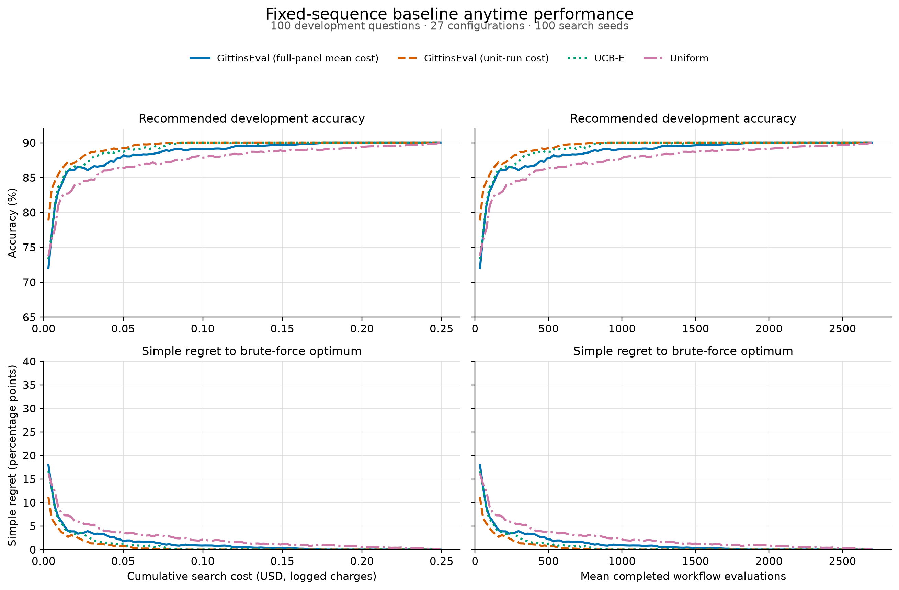
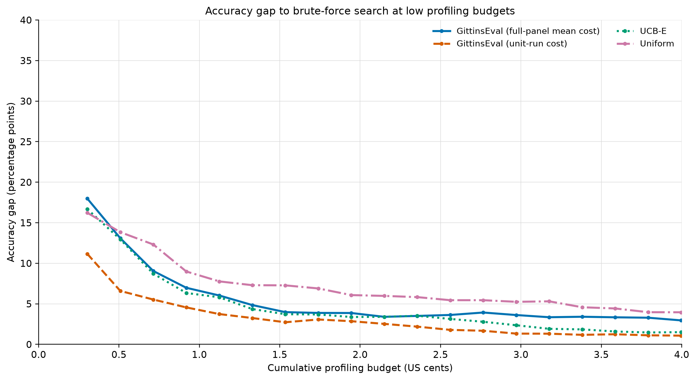
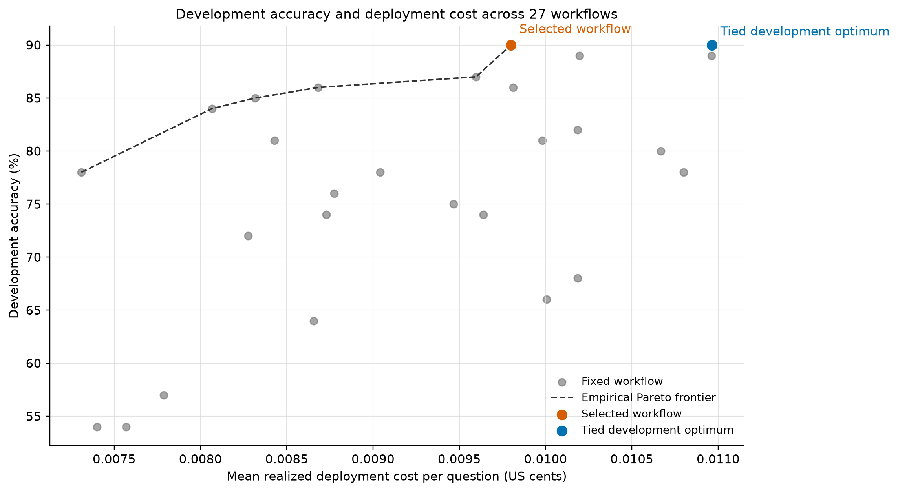

# Retry-Aware Evaluation Framework

This project evaluates fixed solver-verifier workflows with retries on MathQA.
It provides an auditable execution engine, durable SQLite records, independent
answer grading, four offline search baselines, and a completed
100-development/100-reserved-test experiment over 27 one-retry workflows.

Every collected workflow retains its solver and verifier requests, raw
responses, parsed answers, verdicts, token usage, provider identity, latency,
reported cost, and final grade. The committed figures and compact result tables
let collaborators review the completed experiment without rerunning paid model
calls.

## What has been completed

- Constructed a deterministic 200-question sample from the official MathQA test
  split with seed `20261005`, then divided it into 100 development questions and
  100 disjoint reserved-test questions.
- Evaluated all 27 fixed one-retry workflows on the development partition,
  producing 2,700 completed workflow executions.
- Compared GittinsEval with full-panel mean cost, GittinsEval with unit-run cost,
  UCB-E, and Uniform search across 100 offline queue-order seeds.
- Froze the development recommendation before collecting its 100-question
  reserved-test evaluation.
- Exported audit-friendly summaries, matched-budget curves, publication-quality
  PNG/SVG figures, and an interactive workflow diagram.
- Added unit and integration coverage for configuration generation, retry
  semantics, grading, storage, detailed logs, resumable collection, and all four
  search baselines.

## Experiment setup

| Item | Setting |
|---|---|
| Benchmark | MathQA official test split; deterministic 200-question sample |
| Partition | 100 development and 100 reserved-test questions |
| Models | `openai/gpt-oss-20b`, `mistralai/ministral-8b-2512`, `qwen/qwen3-32b` |
| Workflow | Solver `a1`, verifier `v1`, and terminal solver `a2` after rejection |
| Configurations | 27 solver-verifier-solver sequences |
| Development records | 2,700 balanced workflow executions |
| Search methods | GittinsEval/full-panel cost, GittinsEval/unit cost, UCB-E, Uniform |
| Search seeds | 100 offline seeds (`0` through `99`) |
| Maximum horizon | 2,700 purchased records per method and seed |
| Budget alignment | 121 matched realized-USD checkpoints |
| Held-out protocol | Freeze the development recommendation, then evaluate it once on reserved test |

The benchmark SHA-256 is
`b7b7e583c8f2ba8711dd7b1f531e8f5cb1a913f843d6f7aa5feedc67b7f71b32`.
Requests used strict JSON schemas, temperature zero, no response cache, low
reasoning effort for GPT-OSS, and disabled reasoning plus `/no_think` for
Qwen3.

## Results

### Search efficiency

The plots show recommendation accuracy and simple regret as the four search
methods purchase additional saved workflow records. The USD curves use the
historical provider-reported cost of every executed call; the evaluation-count
curves report the mean number of completed workflows at the same matched budget
checkpoints.



The low-budget view highlights how quickly each method reaches a workflow tied
with the development optimum.



| Method | Budget where at least 50% of seeds select an optimum | Budget where at least 90% select an optimum | Regret AUC (percentage-point × USD) | Terminal optimal-selection fraction |
|---|---:|---:|---:|---:|
| GittinsEval, full-panel mean cost | $0.08101 | $0.17131 | 0.3158 | 100% |
| GittinsEval, unit-run cost | **$0.03997** | **$0.07281** | **0.1253** | 100% |
| UCB-E | $0.04613 | $0.08307 | 0.2008 | 100% |
| Uniform | $0.16721 | $0.24724 | 0.5785 | 100% |

The common paid-initialization boundary is $0.003031 and the common terminal
budget is $0.249294. In this experiment, unit-run Gittins reaches the optimum
most efficiently, followed by UCB-E, full-panel-cost Gittins, and Uniform.

### Configuration landscape and reserved-test result

Two workflows reach 90% development accuracy. The deterministic tie rule freezes
configuration `a0d6b38a37fee0a9fe94`:

`Ministral-8B solver → GPT-OSS-20B verifier → GPT-OSS-20B terminal solver`.



| Metric | Estimate | Question-bootstrap 95% interval |
|---|---:|---:|
| Development accuracy | 90% | [84%, 95%] |
| Reserved-test accuracy | 87% | [80%, 93%] |
| Reserved-test mean deployment cost | $0.000090125/question | Descriptive |

| Partition | Workflow executions | Executed calls | Provider-reported cost | Wall time |
|---|---:|---:|---:|---:|
| Development | 2,700 | 6,685 | $0.249294 | 67m 19s |
| Reserved test | 100 | 251 | $0.009012 | 3m 19s |
| **Total** | **2,800** | **6,936** | **$0.258306** | **70m 38s** |

Across both partitions, the run recorded 2,154,296 input tokens, 706,767 output
tokens, and 383,060 reasoning tokens. Every executed call has a recorded cost.

The complete reviewable outputs are available here:

- [interactive workflow diagram](docs/baseline_experiment_workflow.html)
- [experiment summary](docs/results/qian200/experiment_summary.json)
- [baseline summary](docs/results/qian200/baseline_summary.csv)
- [matched-budget curve](docs/results/qian200/matched_budget_curve.csv)
- [configuration summary](docs/results/qian200/configuration_summary.csv)
- [usage summary](docs/results/qian200/usage_summary.csv)
- [PNG and SVG figures](docs/figures/qian200/)

## Environment setup

Python 3.11 or newer is required. Run the following commands from this
directory.

### PowerShell

```powershell
python -m venv .venv
.\.venv\Scripts\Activate.ps1
python -m pip install --upgrade pip
python -m pip install -e ".[analysis]"
```

### Bash, Git Bash, or WSL

```bash
python -m venv .venv
source .venv/bin/activate
python -m pip install --upgrade pip
python -m pip install -e ".[analysis]"
```

The `analysis` extra installs Matplotlib for regenerating figures. The package
itself depends on NumPy. Keep `.venv/` local; it is ignored by Git.

For paid OpenRouter collection, set the API key only in the current shell:

```powershell
$env:OPENROUTER_API_KEY = "sk-or-v1-..."
```

```bash
export OPENROUTER_API_KEY='sk-or-v1-...'
```

Never commit an API key. Offline tests, demos, baseline replay, and figure
inspection do not use OpenRouter credits.

## Run the project

### 1. Verify the implementation offline

```powershell
python -m unittest discover -s tests -v
```

The suite covers the state machine, grading, storage, provider responses,
resumable collection, benchmark loading, and static baselines.

### 2. Run small offline demos

Create an inspectable SQLite ledger and JSON record without network calls:

```powershell
python examples/minimal_record_demo.py `
  --database artifacts/minimal_record.sqlite3 `
  --output artifacts/minimal_record.json
```

Create a small trace for all four search methods:

```powershell
python examples/minimal_static_baseline_demo.py
```

### 3. Prepare the deterministic MathQA benchmark

```powershell
python scripts/prepare_mathqa.py
```

The script downloads the official MathQA archive, validates the 2,985-row test
split, samples 200 rows without replacement, and verifies the frozen manifest in
`data/mathqa/manifest.json`.

### 4. Run the complete collection protocol

This step makes paid OpenRouter calls. Review the model list, question count,
provider routing, and spending limit before starting. From Git Bash or WSL:

```bash
bash scripts/run_qian200_baselines.sh
```

The command collects the balanced development panel, runs the four search
methods, freezes their selected-configuration union, and then collects the
reserved-test records. An interrupted run resumes from its SQLite ledger.
`WORKERS`, `TIMEOUT_SECONDS`, `PYTHON_BIN`, and `RUN_DIR` can override the
defaults.

Monitor an active run with:

```bash
tail -f artifacts/qian200/pipeline_console.log
python scripts/inspect_experiment.py \
  --database artifacts/qian200/development.sqlite3 --recent 20
```

### 5. Replay search and regenerate tables and figures

With the saved panels under `artifacts/qian200/`, replay 100 offline seeds:

```powershell
python scripts/run_static_baselines.py `
  --panel artifacts/qian200/development_panel.jsonl `
  --evaluation-panel artifacts/qian200/reserved_test_panel.jsonl `
  --max-purchases 2700 `
  --seed 0 `
  --seeds 100 `
  --budget-points 121 `
  --curve-csv artifacts/qian200/final_held_out_100_seeds_matched_budget_curve.csv `
  --output artifacts/qian200/final_held_out_100_seeds.json

python scripts/analyze_qian200_results.py
```

This replay makes no model API calls. The first command writes a large full
trace under `artifacts/`; the analysis command refreshes the compact files in
`docs/results/qian200/` and `docs/figures/qian200/`.

## Workflow and audit semantics

For `max_retries = r`, a configuration contains `r + 1` ordered solver models
and `r` ordered verifier models. A verifier acceptance returns the current
answer immediately. A rejection continues to the next solver, and retry
exhaustion returns the final solver response without another verifier call.

The ledger represents every planned call slot as executed, failed,
skipped-after-acceptance, or not-applicable-final. Accuracy is computed from the
returned option and an independently loaded answer key. Search uses saved
development records, while the reserved-test result is evaluated only after the
recommendation is frozen.

Raw SQLite ledgers, detailed request/response JSONL files, and full search traces
remain under `artifacts/qian200/` and are ignored because of their size. Their
SHA-256 hashes are recorded in
`docs/results/qian200/experiment_summary.json`.

## Next steps

1. Predeclare a sensitivity study for the Gittins cost-scaling factor and rerun
   it entirely from the saved development panel.
2. Collect fresh repeated generations for the strongest workflows to separate
   question-sampling variation from model-generation variation.
3. Evaluate adaptive retry-boundary routing with the same ledger, grading, cost,
   and held-out protocol.
4. Expand the reserved-test comparison after freezing a small candidate set,
   then report accuracy, cost, and uncertainty for every frozen candidate.
5. Package the ignored raw audit artifacts in versioned external storage so
   collaborators can reproduce every table and figure from the exact source
   records.
